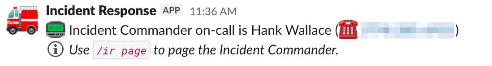
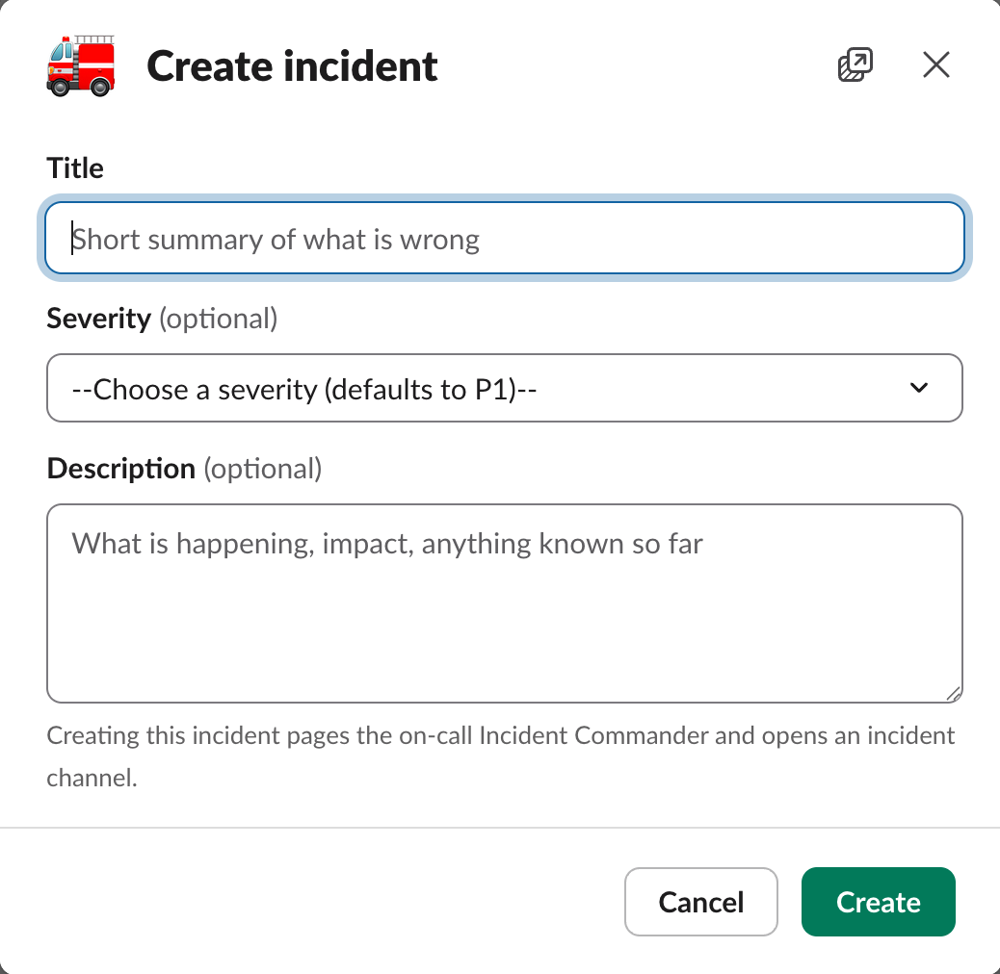
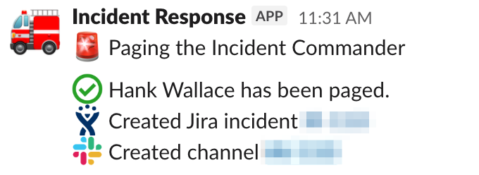
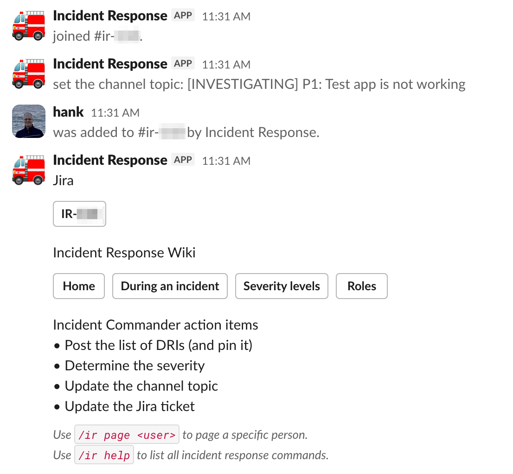
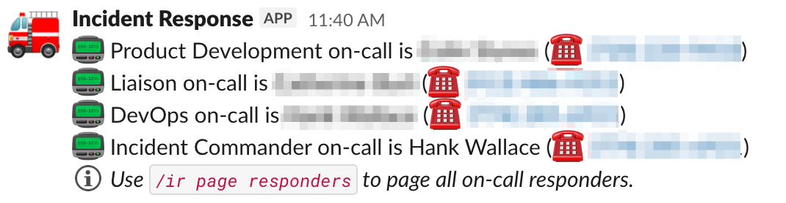
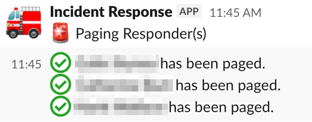
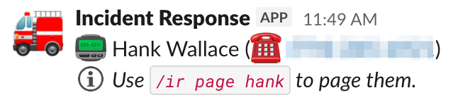
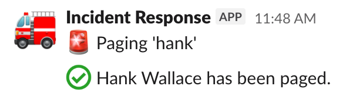
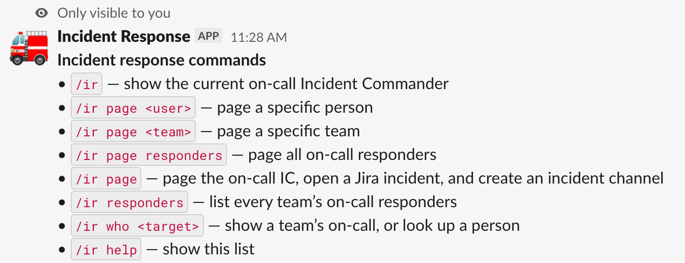

Throughout this documentation, references are made to various chat commands. Incident response actions use Slack slash commands (e.g. `/ir page`), handled by our incident response bot. This page gives an overview of the commands we've referenced in this documentation, and what they do behind the scenes.

## Incident Response

Our `/ir` commands look up on-call schedules in OpsGenie and show each on-call person's name, with their phone number when their Slack profile has one.

### `/ir`
This command lists out the current Incident Commander(s) on-call, their phone numbers, and a message telling users how to page them.

### `/ir page`
This is the command we use to manually trigger our incident response process. It opens a form with three fields: Title, Severity and Description.

When you submit the form, the bot:

* pages the on-call Incident Commander,
* creates an incident in Jira that will be used for reporting purposes, and
* creates a Slack channel for discussions about the incident, named after the Jira key. For example, the Jira incident `IR-99` gets the channel `#ir-99`.

Links to the Jira incident and the new Slack channel are posted in the channel where you ran the command.

The bot adds the Incident Commander to the new channel and posts a message there for responders. The message links to the Jira incident and to these docs, lists the Incident Commander's first actions, and shows the most common `/ir` commands.

If the bot can't page the Incident Commander, it shows you an error message. Run `/ir` to see the Incident Commander's phone number and call them.

### `/ir responders`
This works similarly to the `/ir` command, but it uses all of the team schedules instead of just the Incident Commander schedules. It will list out all the current people who are on-call for each team. This is useful to also know who will likely be joining the incident call momentarily.

### `/ir page responders`
This pages the on-call responder for every team instead of the Incident Commander. This is rarely used, since generally only the relevant team will get paged. However, sometimes we require an "all hands on deck" response, and need the ability to quickly page all the current on-calls. If a team's page fails, the bot posts a warning that names the team.

### `/ir who <target>`
If `<target>` is a team name, this lists that team's current on-call. Otherwise it's treated as a user search — it lists the contact info for the matched person, along with a message telling users how to page them.

For example, `/ir who hank` shows:

### `/ir page <team>`
This pages the on-call responder for one team. Team names are not case-sensitive. If the page fails, the bot posts a warning that names the team.

### `/ir page <user>`
This will page a specific person. If the bot is in the channel where you run the command, it also adds that person to the channel.

For example, `/ir page hank` shows:

Pages sent with `/ir page <user>`, `/ir page <team>` and `/ir page responders` tell the person being paged who paged them and which channel the page came from.

### `/ir help`
This lists every `/ir` command. Only you can see the list.

